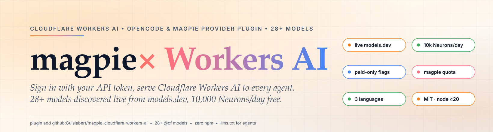

<div align="center">

<a href="https://github.com/Guislabert/magpie-cloudflare-workers-ai">
  <picture>
    <source media="(prefers-color-scheme: dark)" srcset="assets/hero-dark.svg">
    
  </picture>
</a>

</div>

<div align="center">

[][ci]
[][vlg]
[][osi]

</div>

<h1 align="center">@magpie-community/opencode-cloudflare-workers-ai-auth</h1>

<div align="center">

> A provider plugin for OpenCode 1.x and magpie that signs in to Cloudflare Workers AI with your API token — 28+ models discovered live from models.dev, paid-only models flagged, and a daily Neurons allowance in `magpie quota`. English | [简体中文](README.zh-CN.md) | [日本語](README.ja.md)

</div>

> [!NOTE]
> **For AI agents:** this repo ships an [`llms.txt`](llms.txt) with the full agent-facing summary (install command, token permission shape, model naming, paid-model gating). The pipeline description below is the machine-readable README.

<div align="center">

English | [简体中文](README.zh-CN.md) | [日本語](README.ja.md)

</div>

---

> Not affiliated with or endorsed by Cloudflare.

## What you need

| Item | Where to find it |
|---|---|
| Cloudflare Account ID | 32 hex characters, on the dashboard's **Account home** → right sidebar |
| Cloudflare API token | Dashboard → avatar → **My Profile** → API Tokens → create a **Custom Token** with `Account → Workers AI → Edit` (add `Account Settings → Read` if you also want the plan name in `magpie quota`) |
| magpie | 0.1.1110 or later, or OpenCode 1.x |

No zones need to be selected on the token. Free and Paid plans both get
**10,000 Neurons/day** free; eight frontier models need Workers Paid or prepaid
AI Gateway credits (flagged below).

## Install in magpie

```sh
magpie plugin add github:Guislabert/magpie-cloudflare-workers-ai          # from git (this repo)
magpie plugin add /path/to/folder                                        # local copy
```

No npm account is needed anywhere in this flow. npm remains an optional
channel run by the magpie-community org after a plugins-repo merge (trusted
publishing); there is nothing to do on our side.

Then sign in:

```sh
magpie plugin login cloudflare-workers-ai
```

| Prompt | What to enter |
|---|---|
| API Token | the Workers AI:Edit token from the table above |
| Account ID (optional) | 32 hex characters; leave empty to use the plugin's `accountId` option |

- Each sign-in is one account. Sign in again to add another one (e.g. a Free
  account and a Paid account) — magpie fails over between them automatically;
  `magpie quota` shows each account's row separately.
- Sign in again with the same Account ID to replace that account, e.g. to rotate
  the token. Sign-ins are kept in magpie's account storage; nothing is written
  outside magpie's config.
- If Cloudflare refuses the token, magpie marks the account and asks you to sign
  in again.

## Commands you'll actually use

```sh
magpie providers                                                     # is the provider signed in?
magpie provider test cloudflare-workers-ai                           # one small request (~300 ms in our sandbox)
magpie provider test cloudflare-workers-ai @cf/meta/llama-3.3-70b-instruct-fp8-fast
magpie quota                                                         # plan + Neurons/day window
magpie claude cloudflare-workers-ai/@cf/meta/llama-3.3-70b-instruct-fp8-fast   # run Claude Code on it
magpie codex cloudflare-workers-ai/@cf/openai/gpt-oss-120b                     # or Codex, same idea
magpie plugin logout cloudflare-workers-ai                           # remove the sign-in
```

Models are named `cloudflare-workers-ai/@cf/<org>/<model>` — the same IDs
[models.dev](https://models.dev) lists for the provider, refreshed hourly.

### In OpenCode 1.x

`opencode.json`:

```json
{ "plugin": ["/path/to/this-repo"] }
```

(clone the repo and point `plugin` at the local path — same package, no npm)

then `opencode auth login` → Cloudflare Workers AI (same two fields).

## Paid-only models

Eight models are gated by Cloudflare behind Workers Paid or prepaid AI Gateway
credits and are flagged **(Paid)** in the name — that is exactly how the
model picker renders it:

`@cf/moonshotai/kimi-k2.6`,
`@cf/moonshotai/kimi-k2.7-code`, `@cf/zai-org/glm-5.2`, `@cf/zai-org/glm-5.3`,
`@cf/zai-org/glm-5.3-flash`, `@cf/deepseek-ai/deepseek-v4-flash-0731`,
`@cf/deepseek-ai/deepseek-v4.1-flash-1017`,
`@cf/deepseek-ai/deepseek-v4-pro-0813`

Everything else counts only against the shared 10,000 Neurons/day allowance
(billed on a Paid account past it), so no model carries a free badge by design.

## Options

```sh
magpie plugin options opencode-cloudflare-workers-ai-auth '{"accountId": "…", "discoveryTTLMs": 1800000}'
```

| Option | Default | Notes |
|---|---|---|
| `accountId` | — | default Account ID used when a sign-in leaves it empty |
| `apiKey` | — | default token (the sign-in's key wins) |
| `baseTemplate` | see below | template target that the Account ID is interpolated into |
| `discoveryTTLMs` | `3600000` | catalog refresh interval |

**`baseTemplate` default** (insertion target, Account ID interpolated per account):

```
https://api.cloudflare.com/client/v4/accounts/${CLOUDFLARE_ACCOUNT_ID}/ai/v1
```

## Troubleshooting

| You see | Meaning |
|---|---|
| Model list empty, provider missing | `magpie plugin add .` again, then `magpie plugin --json`: the `error` field says why (catalog fetch failed, or the token was refused) |
| `magpie: the sign-in failed: 需要 API Token` | the token prompt was left empty — re-run `magpie plugin login cloudflare-workers-ai` |
| 401 `Authentication error` from `provider test` | the token was refused: check scope (`Workers AI:Edit`) or sign in again |
| 403 from `provider test`  | token and Account ID don't match |
| 400 `No route for that URI` | if this survives a re-`plugin add`, it's a stale plugin version — the current proxy normalizes template URLs; file an issue |
| `Model … absent from the current catalog` | the model id isn't in models.dev's cloudflare-workers-ai section; pick a listed model |
| 400 on a (Paid) model | your plan is Free and the model needs Workers Paid or AI Gateway credits |
| Quota row shows the fallback plan text | the token lacks `Account Settings → Read`; the escalation is purely cosmetic — the Neurons window is still shown |

## Development

```sh
node --check src/index.mjs       # parse guard (the upstream bug that started this fork)
node --test                     # 11 tests, no network needed
sh scripts/sandbox.sh login      # magpie 0.1.1326 in a throwaway HOME
sh scripts/sandbox.sh test       # provider test inside that sandbox
sh scripts/sandbox.sh json       # plugin --json inside that sandbox
```

`scripts/sandbox.sh` keeps its HOME in `.sandbox/` (git-ignored), so your real
magpie, agents and sign-ins are never touched.

## Plugin contract notes

- Single async plugin function; `config`, `auth.methods` (one `api` method with
  `password` prompts), `auth.loader`, `auth.usage` and `provider.models` hooks
- `loader(getAuth, provider)` reads the contract account shape (`auth.key`,
  `auth.metadata.accountId`); the legacy OpenCode multi-method shape works too
- `authorize` returns `{ type: "success", key, metadata }` / `{ type: "failed", error }`
- On catalog failure at load, `config()` degrades to an empty model list instead
  of throwing; the per-account `provider.models` serves the cached catalog after
- One file, zero runtime dependencies, ESM, `node >= 20`

## Acknowledgements

- **Registry**: live model list comes from [models.dev](https://models.dev); built within the [magpie](https://usemagpie.ai) / OpenCode provider plugin ecosystem.
- **Header/layout**: [readme-harness](https://github.com/Guislabert/readme-harness) v0.1.0 (@`8c65495`).

## Version / license

| | |
|---|---|
| **Version** | 0.0.3 |
| **License** | [MIT](LICENSE) — Copyright (c) 2026 Guislabert |
| **Runtime** | Node.js >= 20, ESM only |
| **Author** | [@Guislabert](https://github.com/Guislabert) |
| **中文** | [README.zh-CN.md](README.zh-CN.md) |

MIT © [Guislabert](https://github.com/Guislabert)

---

_Layout: [readme-harness](https://github.com/Guislabert/readme-harness) v0.1.0 @`8c65495` · baseline: [docs/readme-harness.md](docs/readme-harness.md)_

[ci]: https://github.com/Guislabert/magpie-cloudflare-workers-ai/actions
[vlg]: CHANGELOG.md
[osi]: https://opensource.org/licenses/MIT
